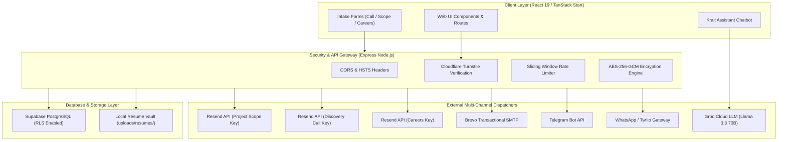
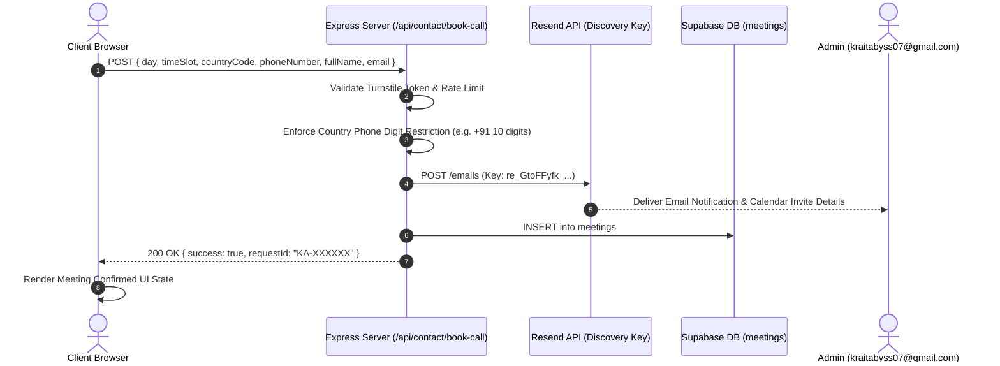
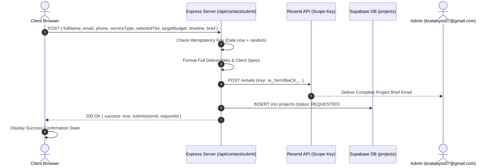
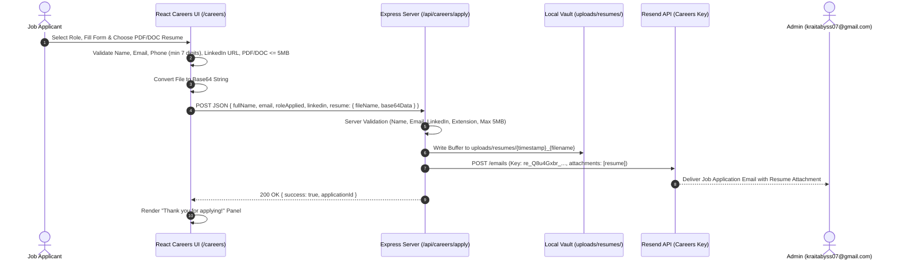

# KRAIT ABYSS ENTERPRISE PLATFORM — TECHNICAL ARCHITECTURE & ENVIRONMENT DOCUMENTATION

> **PRODUCTION SYSTEM SPECIFICATION & DOCUMENTATION MANUAL**
> Version: 2.0.0 | Release: Production Ready

---

## 1. Executive System Overview & Master Admin Credentials

Krait Abyss (`https://kraitabyss.com`) is an enterprise-grade technology studio web platform and automated backend infrastructure built for high-concurrency client intake, AI agent swarms, project scope engineering, document verification (e.g. Record Writers platform), and career recruitment.

### Master Admin Credentials
- **Admin Portal Route**: `/login` & `/dashboard`
- **Admin Email**: `kraitabyss07@gmail.com`
- **Admin Password**: `Krait@5678`
- **WhatsApp Alert Target**: `+917386613995`



---

## 2. Environment Configuration & Key Directory

This section provides the complete reference for every environment variable, API key, JWT secret, and SMTP key configured in `.env`.

### 2.1 Client-Side Public Keys
| Variable Name | Description & Usage | Production Configured Value |
| :--- | :--- | :--- |
| `VITE_SUPABASE_URL` | Endpoint URL for Supabase backend services. Used by client components to query public project showcases and authentication states. | `https://epwmvtlnxkixoyuflxuy.supabase.co` |
| `VITE_SUPABASE_PUBLISHABLE_KEY` | Public anonymous API key for client-side Supabase requests (read access governed by Row-Level Security). | `[CONFIGURED_IN_NETLIFY]` |
| `VITE_TURNSTILE_SITE_KEY` | Cloudflare Turnstile public site key rendered in frontend anti-bot challenge widgets. | `[CONFIGURED_IN_NETLIFY]` |

### 2.2 Server-Side Private Secrets & Authentication Keys
| Variable Name | Description & Usage | Production Configured Value |
| :--- | :--- | :--- |
| `SUPABASE_URL` | Server-side reference URL for administrative database queries. | `https://epwmvtlnxkixoyuflxuy.supabase.co` |
| `SUPABASE_SERVICE_ROLE_KEY` | High-privilege administrative secret key for server-side Supabase access, bypassing RLS for system syncs. | `[CONFIGURED_IN_NETLIFY]` |
| `SUPABASE_JWT_SECRET` | Secret key used to sign, decode, and verify JSON Web Tokens (JWT) for authenticated admin & client user sessions. | `[CONFIGURED_IN_NETLIFY]` |
| `TWO_FACTOR_ENCRYPTION_KEY` | 256-bit hexadecimal key used by AES-256-GCM encryption routines (`encryption.ts`) to encrypt user TOTP secrets at rest in `user_2fa`. | `[CONFIGURED_IN_NETLIFY]` |
| `TURNSTILE_SECRET_KEY` | Cloudflare Turnstile private secret key used on Express backend (`/api/contact/submit`, `/api/contact/book-call`) to verify client challenge tokens. | `[CONFIGURED_IN_NETLIFY]` |

### 2.3 Administrative Credentials & Targets
| Variable Name | Description & Usage | Production Configured Value |
| :--- | :--- | :--- |
| `ADMIN_EMAIL` | Main recipient email address for all lead inquiries, call bookings, careers applications, and security alerts. | `kraitabyss07@gmail.com` |
| `ADMIN_PASSWORD` | Master password for administrative access to internal studio management controls. | `[CONFIGURED_IN_NETLIFY]` |
| `WHATSAPP_ADMIN_NUMBER` | Target phone number receiving automated WhatsApp lead alerts. | `+917386613995` |

### 2.4 Resend API & Transactional Email Dispatchers
The platform utilizes dedicated Resend API keys segmented by notification channel to ensure optimal deliverability, domain reputation isolation, and rate limit allocation:

| API Key / Identifier | Channel Purpose | Key Value |
| :--- | :--- | :--- |
| `RESEND_API_KEY` (Default / Scope) | Handles Project Scope Inquiry Brief notifications from `/contact`. | `[CONFIGURED_IN_NETLIFY]` |
| `RESEND_DISCOVERY_KEY` | Handles Quick Discovery Call scheduling requests (15-min chat) from `/contact`. | `[CONFIGURED_IN_NETLIFY]` |
| `RESEND_CAREERS_KEY` | Handles Job Applications & PDF/DOC resume file attachments from `/careers`. | `[CONFIGURED_IN_NETLIFY]` |

### 2.5 Brevo (Sendinblue) SMTP Fallback
Used as a high-reliability secondary email fallback dispatcher in `server/twoFactorServer.ts` if Resend API encounters rate limits:

| Variable Name | Description & Usage | Production Configured Value |
| :--- | :--- | :--- |
| `SMTP_HOST` | Transactional SMTP relay host. | `smtp-relay.brevo.com` |
| `SMTP_PORT` | TLS SMTP port. | `587` |
| `SMTP_USER` | SMTP authentication email user. | `kraitabyss07@gmail.com` |
| `SMTP_KEY` / `BREVO_API_KEY` | Brevo API key for HTTP v3 SMTP email dispatch. | `[CONFIGURED_IN_NETLIFY]` |

### 2.6 AI Assistant LLM Provider (Groq Cloud API)
| Variable Name | Description & Usage | Production Configured Value |
| :--- | :--- | :--- |
| `GROQ_API_KEY` / `LLM_API_KEY` | Groq Cloud API key powering Krait Assistant chatbot with ultra-fast inference. | `[CONFIGURED_IN_NETLIFY]` |
| `AI_PROVIDER` | Active LLM backend provider identifier. | `groq` |
| `AI_MODEL` | Deep reasoning & conversational model identifier. | `llama-3.3-70b-versatile` |
| `AI_BASE_URL` | OpenAI-compatible Groq API endpoint URL. | `https://api.groq.com/openai/v1` |

---

## 3. Detailed Data Flow & Sequence Diagrams

### 3.1 Quick Discovery Call Flow


### 3.2 Project Scope Inquiry Brief Flow


### 3.3 Careers Job Application & Resume Upload Flow


---

## 4. Database Schema Reference (Supabase PostgreSQL)

### 4.1 `projects` Table
```sql
CREATE TABLE public.projects (
    id UUID PRIMARY KEY DEFAULT gen_random_uuid(),
    name TEXT NOT NULL,
    user_email TEXT NOT NULL,
    user_name TEXT,
    client_name TEXT,
    category TEXT,
    service_type TEXT,
    description TEXT,
    what_we_did TEXT,
    technologies TEXT[],
    budget_range TEXT,
    timeline TEXT,
    image_url TEXT,
    project_link TEXT,
    completion_date TIMESTAMP WITH TIME ZONE,
    status TEXT DEFAULT 'REQUESTED',
    published BOOLEAN DEFAULT false,
    sort_order INT DEFAULT 0,
    created_at TIMESTAMP WITH TIME ZONE DEFAULT now(),
    updated_at TIMESTAMP WITH TIME ZONE DEFAULT now()
);
```

### 4.2 `meetings` Table
```sql
CREATE TABLE public.meetings (
    id UUID PRIMARY KEY DEFAULT gen_random_uuid(),
    user_email TEXT NOT NULL,
    user_name TEXT NOT NULL,
    meeting_type TEXT NOT NULL DEFAULT 'Quick Discovery Call',
    preferred_date DATE NOT NULL,
    preferred_time TEXT NOT NULL,
    call_duration TEXT DEFAULT '15 min',
    description TEXT,
    status TEXT DEFAULT 'REQUESTED',
    created_at TIMESTAMP WITH TIME ZONE DEFAULT now()
);
```

### 4.3 `career_applications` Table
```sql
CREATE TABLE public.career_applications (
    id UUID PRIMARY KEY DEFAULT gen_random_uuid(),
    full_name TEXT NOT NULL,
    email TEXT NOT NULL,
    phone TEXT,
    location TEXT,
    role_applied TEXT NOT NULL,
    portfolio_url TEXT,
    cover_note TEXT,
    resume_url TEXT,
    created_at TIMESTAMP WITH TIME ZONE DEFAULT now()
);
```

### 4.4 `user_2fa` Table
```sql
CREATE TABLE public.user_2fa (
    user_id UUID PRIMARY KEY REFERENCES auth.users(id) ON DELETE CASCADE,
    encrypted_secret TEXT NOT NULL,
    is_enabled BOOLEAN DEFAULT false,
    backup_code_hashes TEXT[],
    created_at TIMESTAMP WITH TIME ZONE DEFAULT now(),
    updated_at TIMESTAMP WITH TIME ZONE DEFAULT now()
);
```

---

## 5. Security Architecture & OWASP ASVS Controls

1. **Zero-Trust Secret Storage**:
   - 2FA secrets are encrypted using AES-256-GCM (`TWO_FACTOR_ENCRYPTION_KEY`) before insertion into `user_2fa`.
   - Backup codes are hashed using SHA-256 before storage.

2. **CORS & Defensive Headers**:
   - Strict origin whitelist permitting only `https://kraitabyss.com`, `http://localhost:8080`, and Netlify subdomains.
   - HSTS header enforced: `max-age=31536000; includeSubDomains; preload`.

3. **Anti-Bot & Rate Limiting Protection**:
   - Cloudflare Turnstile token validation on all lead endpoints.
   - Sliding-window rate limit memory store (`checkRateLimit`) preventing brute-force submissions.

4. **File Security**:
   - Resume uploads validated for file extension (`.pdf`, `.doc`, `.docx`), MIME type, and size (`<= 5 MB`).
   - Server sanitizes filenames to prevent path traversal attacks.
   - Executables (`.exe`, `.sh`, `.bat`, `.js`, `.zip`) are strictly rejected.

---

## 6. Operational Mechanics & Team Presentation Guide

### 6.1 How the System Works End-to-End
1. **Client Interaction**:
   - Prospective clients land on `https://kraitabyss.com` built on React 19 and TanStack Router.
   - They explore 6 Core Services (`/services`), interactive 3D rotary globe visualizers, and Verified Production Case Studies (`/work`).

2. **Lead Intake & Phone Validation**:
   - When a client books a 15-min discovery call or submits a project brief on `/contact`:
     - The country selector maps their region and enforces strict digit limits (e.g., exactly 10 digits for India `+91`).
     - Submissions post to Express backend endpoints (`/api/contact/book-call` & `/api/contact/submit`).

3. **Zero-Trust Backend Processing**:
   - Express checks Cloudflare Turnstile security tokens and evaluates sliding-window rate limits.
   - Idempotency keys prevent double submissions if the button is clicked twice.
   - The server formats the full brief, scope deliverables, budget currency, and contact numbers.

4. **Multi-Channel Admin Notification**:
   - The backend dispatches notifications asynchronously across:
     - **Email**: Sent to `kraitabyss07@gmail.com` using dedicated channel keys (`re_YenVBwCK_...`, `re_GtoFFyfk_...`, `re_Q8u4Gxbr_...`) with Brevo SMTP fallback.
     - **Telegram Bot**: Dispatches instant chat notifications to the administrative Telegram channel.
     - **WhatsApp**: Triggers Twilio/WhatsApp alert to `+917386613995`.
     - **Supabase Database**: Persists lead records to `projects`, `meetings`, or `career_applications`.

5. **Careers Application & Resume Vault**:
   - Applicants on `/careers` submit details alongside a PDF/DOC resume.
   - The browser converts the resume file to base64, which POSTs to `/api/careers/apply`.
   - Express verifies file extension, size (`<= 5 MB`), writes the file buffer to `uploads/resumes/`, and emails `kraitabyss07@gmail.com` with the attached resume.

6. **Admin Dashboard & Control**:
   - Admins log in at `/login` using `kraitabyss07@gmail.com` / `Krait@5678`.
   - The `/dashboard` panel allows admins to view meeting requests, manage project showcase listings, and monitor platform telemetries in real time.
